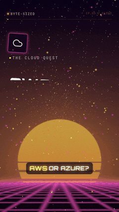
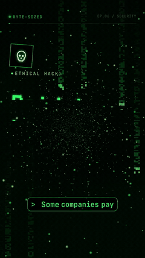
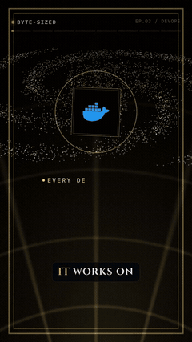
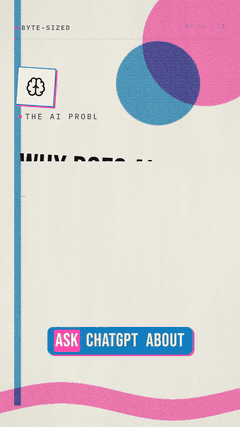
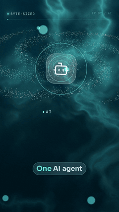
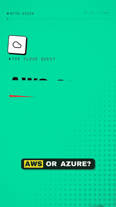
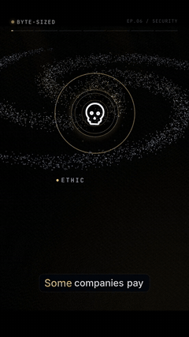
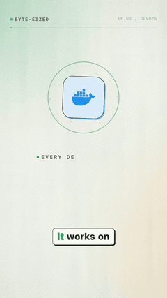
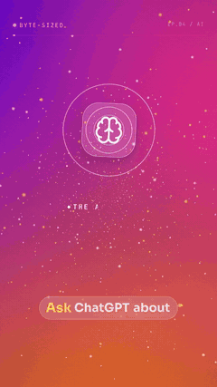
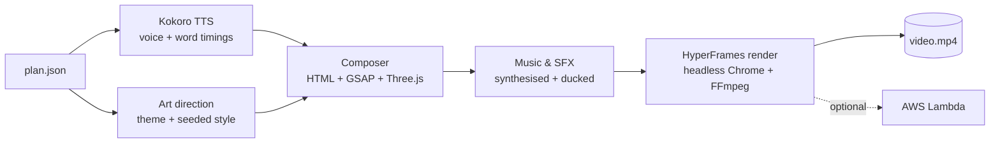

<div align="center">

# 🎬 code-to-video

### Studio-quality animated tech explainers for **$0**

Turn a tech topic into a finished 9:16 short, with voice-over, captions, music, sound effects, motion graphics and 3D.<br/>
It runs on your own computer using only free, open-source tools. You need no API keys, no subscriptions and no GPU.

    

    

</div>

---

## Why

Animated explainers like the ones on big YouTube Shorts and Reels channels usually need a motion designer, a voice actor, a music licence and paid AI tools. **code-to-video does the whole job for $0:**

| What the video needs | What usually does it (paid) | What code-to-video uses (free) |
|---|---|---|
| Script and storyboard | Copywriter / ChatGPT Plus | A JSON plan (write it yourself or paste a prompt into any free chatbot) |
| Voice-over | ElevenLabs ($5–$99/mo) | **Kokoro-82M** TTS, running locally (Apache-2.0) |
| Motion graphics | After Effects ($23/mo) + designer | **HyperFrames** (HTML + **GSAP** + **Three.js**) |
| Music and SFX | Epidemic Sound ($10–$50/mo) | **Generated from code**: original music on every render, so there's nothing to license |
| Icons and logos | Icon packs | **aws-icons** (MIT), **simple-icons** (CC0), **lucide** (ISC): about 5,500 icons |
| Fonts | Adobe Fonts | 17 **Google / Fontsource** families (OFL) |
| Rendering | Cloud render farm | Your CPU + **FFmpeg** (or the AWS Lambda free tier) |
| **Monthly cost** | **$50–$200+** | **$0** |

## Sample output

Each video below was made by this repo from a plan in [`plans/`](plans) or [`examples/`](examples). Click a preview to open the full MP4, which has sound.

| | | |
|:-:|:-:|:-:|
| [](media/videos/aws-vs-azure__outrun.mp4)<br/>**AWS vs Azure** · `outrun` | [](media/videos/red-team__terminal.mp4)<br/>**What is a Red Team?** · `terminal` | [](media/videos/multi-agent-systems__ocean.mp4)<br/>**Multi-Agent Systems** · `ocean` |
| [](media/videos/docker__luxe.mp4)<br/>**What is Docker?** · `luxe` | [](media/videos/rag__riso.mp4)<br/>**What is RAG?** · `riso` | [](media/videos/aws-vs-azure__brutal.mp4)<br/>**AWS vs Azure** · `brutal` |
| [](media/videos/red-team__cinema.mp4)<br/>**What is a Red Team?** · `cinema` | [](media/videos/docker__paper.mp4)<br/>**What is Docker?** · `paper` | [](media/videos/rag__glass.mp4)<br/>**What is RAG?** · `glass` |

The same plan can produce completely different videos. **AWS vs Azure**, for example, comes out as retro synthwave in `outrun` and as bold poster blocks in `brutal`.

### All 22 themes


## Features

- 🎙️ **Natural voice-over:** Kokoro TTS with 20+ voices. Tech acronyms are spelled out (EC2 is read as "E C 2", AWS as "A W S").
- 💬 **Word-by-word captions:** 3-word groups, with each word highlighted as it is spoken. 19 caption styles.
- 🎨 **22 themes:** each one is a complete visual language, with its own animated shader background, fonts, cards, captions, transitions, camera move and music genre. [See all themes →](docs/THEMES.md)
- 🎞️ **11 animated scene types:** `hook`, `stat`, `cards`, `flow`, `chart`, `compare`, `steps`, `code`, `scale`, `orbit` and `outro`.
- 🧊 **3D moments:** a warp tunnel, a particle galaxy, a globe with network arcs, and floating wireframe shards.
- 🎵 **Original score:** 15 music genres (synthwave, lo-fi, trap, orchestral, chiptune, jazz-hop and more) are synthesised from code and ducked under the voice. Every on-screen event gets a whoosh, pop, tick, riser or impact.
- 🔁 **Never the same twice:** themes rotate automatically so consecutive videos never share a look. A seed varies the palette, font, camera, hook layout and music key inside each theme.
- ♻️ **Deterministic:** the same plan and seed always give the same frames, so re-renders are reproducible.
- ☁️ **Optional serverless rendering** on AWS Lambda, which splits the render into parallel chunks.

## Quick start

### Windows

```bat
git clone https://github.com/arunprasath403/code-to-video.git
cd code-to-video
powershell -ExecutionPolicy Bypass -File setup.ps1
```

`setup.ps1` installs Node.js, FFmpeg and Python 3.12 with `winget` if they are missing, the voice model packages, the npm packages and the render browser. **Then open a new terminal** and run:

```bat
c2v doctor
c2v make plans\multi-agent-systems.json
```

### macOS / Linux

```bash
git clone https://github.com/arunprasath403/code-to-video.git && cd code-to-video
# needs Node 20+, FFmpeg and Python 3.10+
python3 -m pip install kokoro-onnx soundfile
npm install
npx hyperframes browser ensure
./c2v doctor
./c2v make plans/multi-agent-systems.json
```

The video is written to `videos/<title>.mp4`.

## Make a video about any topic

You don't need a local LLM. Get the plan from any chatbot:

```bash
c2v prompt "What is Kubernetes?"   # prints a complete brief and saves it to plans/
```

1. Paste the brief into Claude, ChatGPT or Gemini (the free tiers work).
2. Save the JSON reply as `plans/what-is-kubernetes.json`.
3. Validate it, then render it:

```bash
c2v check plans/what-is-kubernetes.json
c2v make  plans/what-is-kubernetes.json --theme cosmos
```

Or write the plan by hand; the format is short and readable. See [docs/PLAN-FORMAT.md](docs/PLAN-FORMAT.md).

## Commands

| Command | What it does |
|---|---|
| `c2v make <plan.json>` | Voice, animate, score and render a plan |
| `c2v prompt "<topic>"` | Print a ready-to-paste brief that makes any chatbot write a valid plan |
| `c2v check <plan.json>` | Validate a plan and report its length |
| `c2v themes` | List all 22 themes |
| `c2v voices` | List TTS voices |
| `c2v render <projectDir>` | Re-render a built project |
| `c2v doctor` | Check Node, FFmpeg, Python voice and Chrome |
| `c2v lambda-deploy` | One-time: deploy the renderer to your AWS account |

| Option | Default | Meaning |
|---|---|---|
| `--theme <name>` | rotates | Any of the 22 themes, e.g. `noir`, `outrun`, `swiss` |
| `--seed <n\|random>` | from title | Changes palette, font, camera and music inside a theme |
| `--voice <id>` | `am_michael` | e.g. `af_heart`, `bm_george`, `bf_emma` |
| `--speed <x>` | `1.05` | Narration speed |
| `--music <file.wav>` | generated | Use your own music bed |
| `--quality <q>` | `high` | `draft`, `standard` or `high` |
| `--lambda` | off | Render on AWS Lambda |
| `--no-render` | off | Build only, then preview with `npx hyperframes preview projects/<name>` |

Your channel name and handle (shown on screen) live in `c2v.config.json`, which is created on the first run.

## How it works



Read [docs/ARCHITECTURE.md](docs/ARCHITECTURE.md) for the full pipeline.

## Performance

A 40–50 second video at 1080×1920, 30 fps takes about **4–5 minutes on a 4-core CPU**. A modern 8–16 core laptop is faster, and no GPU is needed. The first run also downloads the voice model (about 300 MB) and the render browser.

## Documentation

- [Themes](docs/THEMES.md): all 22 visual languages
- [Plan format](docs/PLAN-FORMAT.md): every scene type, with examples
- [Architecture](docs/ARCHITECTURE.md): how a plan becomes a video
- [AWS Lambda rendering](docs/LAMBDA.md)
- [Troubleshooting](docs/TROUBLESHOOTING.md)
- [Contributing](CONTRIBUTING.md): add a theme or a scene type

## Credits and licences

The code in this repository is **MIT**. It is built on:
- [HyperFrames](https://www.npmjs.com/package/hyperframes) (Apache-2.0)
- [GSAP](https://gsap.com) (free standard licence)
- [Three.js](https://threejs.org) (MIT)
- [Kokoro-82M](https://huggingface.co/hexgrad/Kokoro-82M) (Apache-2.0)
- [aws-icons](https://www.npmjs.com/package/aws-icons) (MIT)
- [simple-icons](https://simpleicons.org) (CC0)
- [lucide](https://lucide.dev) (ISC)
- [Fontsource](https://fontsource.org) fonts (OFL)

Brand logos are trademarks of their owners. They are used only to refer to the product, not to imply endorsement.

<div align="center">

If this saved you a subscription, please ⭐ the repo.

</div>
