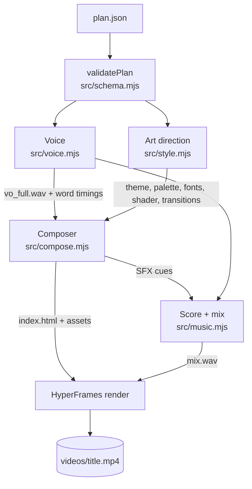

# Architecture

## 1. Plan and validation (`src/schema.mjs`)

The validator checks every scene and repairs what it can:
- unknown types
- text that is too long
- cue words that are not in the narration
- missing icons

The same file holds the scene vocabulary that `c2v prompt` sends to a chatbot.

## 2. Voice (`src/voice.mjs`)

1. Each scene's `say` is cleaned for speech: acronyms are spelled out (EC2 becomes "E C 2"), and symbols become words.
2. **Kokoro-82M** synthesises the scenes 3 in parallel through `hyperframes tts`, running locally on ONNX.
3. Results are cached by text, voice and speed, so re-renders skip synthesis.
4. Word timings are estimated from the speech and silence in each clip. For exact timings, `--whisper` runs whisper.cpp locally.
5. The scenes are joined with short gaps into one 48 kHz voice track.

## 3. Art direction (`src/style.mjs`)

1. A seed is hashed from the title, so the same topic always gives the same look.
2. `pickTheme` avoids the last three themes used.
3. The theme then decides:
   - which shader background to use
   - the palette, with a background tint for each scene
   - the fonts, card class, caption style, transitions and camera move
   - the 3D moments and the music genre

## 4. Composition (`src/compose.mjs` + `template/`)

`compose` writes a self-contained **HyperFrames** project:

- **`index.html`**
  - one clip per scene
  - one track each for background, 3D, transitions, letterbox, progress, brand, captions and audio
  - the plan and style data as `window.PLAN`
- **`template/engine.js`**
  - builds a single paused **GSAP** timeline: scene builders, transitions, camera moves and captions
  - the timeline is seek-driven, so the same time always gives the same frame
- **`template/visuals.js`**
  - one WebGL fragment shader with 25 background modes
  - **Three.js** 3D moments: warp, galaxy, globe and shards
  - both redraw on every `hf-seek` event, so frame capture is deterministic
- **`template/style.css`**
  - layout, the 17 font families, and per-theme card and caption styles

Icons are resolved and recoloured to match the theme (`src/icons.mjs`).

## 5. Score and mix (`src/music.mjs`)

- **No samples:** the music is synthesised from the seed.
  - pads with a filter
  - a melodic layer: arpeggios, plucks, keys, bells, chiptune or an acid line
  - bass: pulse, walking, offbeat or 808
  - drums, with sidechain pumping
  - 15 genre presets
- **SFX at every event:** whooshes on transitions, pops when items appear, ticks on counters, impacts on the hook and outro, and a riser before the end.
- **Ducking:** the music drops under the voice, then a soft limiter normalises the mix.

## 6. Render

`hyperframes render` drives headless Chrome frame by frame and encodes with FFmpeg: H.264 video and AAC 48 kHz stereo audio.
- `--lambda` sends the same project to AWS Lambda, which renders chunks in parallel.
- Output is 1080×1920 at 30 fps.
