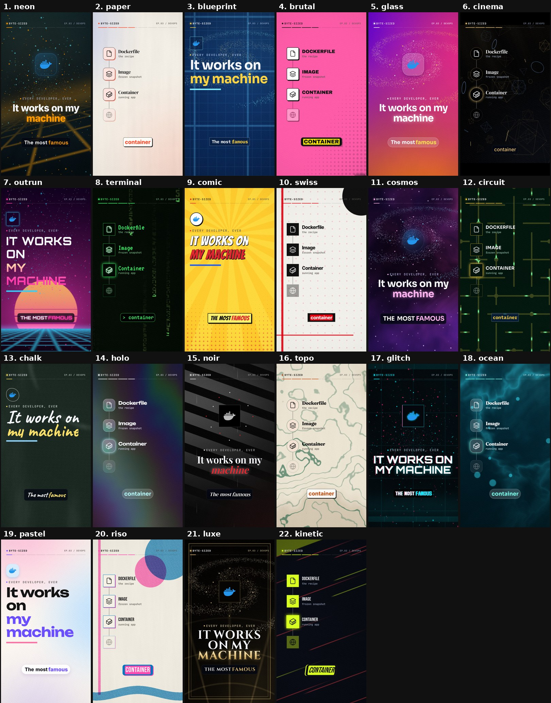

# Themes

Every video gets one of **22 themes**. A theme is a complete visual language, not a colour swap. It sets:
- the animated background, drawn by a WebGL shader
- the display and body fonts
- the card style and the caption style
- the scene transitions
- the hook layout
- the 3D moments
- the music genre



## Choosing a theme

- **Automatic (default):** themes rotate, and a new video never reuses any of the last three looks. The history is kept in `c2v.config.json`.
- **Per run:** `c2v make plans/x.json --theme noir`
- **Per plan:** add `"theme": "noir"` to the plan JSON.
- **Variation inside a theme:** `--seed random` picks a different palette, display font, transition order, camera move (push, drift or float), hook layout and music key or tempo.

## The 22 themes

| Theme | Look | Display font | Transitions | Music |
|---|---|---|---|---|
| `neon` | dark, glowing shader smoke / aurora / synth grid / bokeh | Space Grotesk / Inter | slide, zoom, rise, flip | synthwave |
| `paper` | warm paper, ink outlines, offset shadows (editorial) | DM Serif Display | colour wipe, push, iris | lo-fi |
| `blueprint` | drafting-table blue grid, dashed outlines, mono labels | Sora | slice, slide, iris | minimal techno |
| `brutal` | solid colour blocks per scene, halftone, thick borders, hard shadows | Archivo Black | colour wipe, slice, push | punchy drums and bass |
| `glass` | vivid moving mesh gradient, frosted-glass cards | Unbounded / Sora | zoom, iris, rise | uplifting plucks |
| `cinema` | black set, light shafts, letterbox, floating 3D wireframes | Playfair Display | dip to black, zoom, push | cinematic drones and booms |
| `outrun` | retro sunset, striped sun, neon grid floor | Orbitron | slide, zoom, glitch | outrun synth with pulse bass |
| `terminal` | falling code rain, phosphor glow, `>` prompt captions | VT323 | slice, glitch, slide | dark techno with an acid line |
| `comic` | pop-art sunburst, halftone dots, speech-box captions | Bangers | zoom, colour wipe, flash | bouncy stabs |
| `swiss` | off-white, dot grid, red disc, hard rules | Inter | slice, push, slide | minimal techno |
| `cosmos` | nebula clouds, twinkling stars | Syne / Sora | zoom, rise, iris | ambient bells and drone |
| `circuit` | circuit-board traces with travelling pulses, chip cards | Orbitron / Sora | slice, iris, glitch | dark techno |
| `chalk` | chalkboard, smudges, hand-written type | Caveat | push, rise, iris | lo-fi |
| `holo` | iridescent foil sheen, holographic text | Syne / Unbounded | zoom, flip, rise | house |
| `noir` | black and white, light through blinds, rain | DM Serif / Playfair | dip, push, slice | jazz-hop with walking bass |
| `topo` | topographic contour map, earthy tones | Fraunces | colour wipe, iris, push | ambient |
| `glitch` | CRT scanlines, screen tearing, RGB split | VT323 / Orbitron | glitch, flash, slice | chiptune |
| `ocean` | deep water, caustics, light rays, bubbles | Sora / Fraunces | rise, zoom, iris | ambient |
| `pastel` | soft drifting colour blobs on cream | Syne / Unbounded | rise, zoom, iris | house |
| `riso` | risograph two-ink print, grain, misregistration | Bebas Neue | colour wipe, slice, push | bouncy stabs |
| `luxe` | black and gold art-deco fan and double frame | Cinzel | dip, iris, zoom | orchestral |
| `kinetic` | sports-style speed lines, skewed cards | Bebas Neue | push, flash, glitch, slice | trap (808s, hat rolls) |

`c2v themes` prints the same list from the code:

```text
  neon       dark   bg smoke/aurora/grid/bokeh    font Grotesk/Inter      music synthwave
  paper      light  bg paper                      font DMSerif            music lofi
  blueprint  dark   bg blueprint                  font Sora               music minimal
  brutal     light  bg blocks                     font Archivo            music punchy
  glass      dark   bg mesh                       font Unbounded/Sora     music uplift
  cinema     dark   bg cinema                     font Playfair           music cinematic
  outrun     dark   bg sunset                     font Orbitron           music outrun
  terminal   dark   bg rain                       font VT323              music dark
  comic      light  bg burst                      font Bangers            music bounce
  swiss      light  bg dots                       font Inter              music minimal
  cosmos     dark   bg nebula                     font Syne/Sora          music ambient
  circuit    dark   bg circuit                    font Orbitron/Sora      music dark
  chalk      dark   bg chalk                      font Caveat             music lofi
  holo       dark   bg holo                       font Syne/Unbounded     music house
  noir       dark   bg noir                       font DMSerif/Playfair   music jazz
  topo       light  bg topo                       font Fraunces           music ambient
  glitch     dark   bg crt                        font VT323/Orbitron     music chip
  ocean      dark   bg ocean                      font Sora/Fraunces      music ambient
  pastel     light  bg pastel                     font Syne/Unbounded     music house
  riso       light  bg riso                       font Bebas              music bounce
  luxe       dark   bg deco                       font Cinzel             music orchestral
  kinetic    dark   bg speed                      font Bebas              music trap
```

## Make your own theme

See [CONTRIBUTING.md](../CONTRIBUTING.md#add-a-theme).
